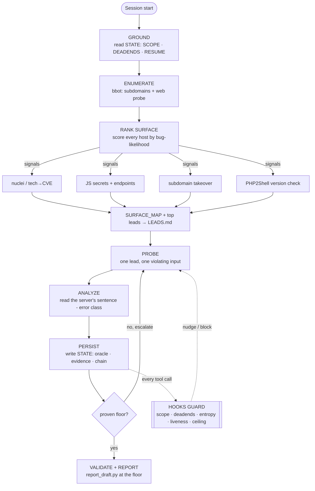

# MYTHOS + Lounge — a hunter operating system for an LLM security agent

A **file-system-as-brain** operating system that turns an LLM coding agent (built for **Claude
Code**) into a disciplined, resumable **bug-bounty / VRP** hunter — plus **Lounge**, a two-agent
coordination layer. The agent's memory, discipline and state live on **disk**; a set of
**hooks + doctrine + skills** force a repeatable loop and catch the ways an LLM predictably goes
wrong on a long hunt.

> Built for **authorized, program-scoped** security research only. Every piece assumes a
> signed-off `SCOPE.md` and a human who submits. Enumeration/exploitation is gated to scope,
> and anything destructive is human-gated. This bundle is **framework only** — all live hunt
> data, findings and identifiers were scrubbed (see [`REDACTION_NOTES.md`](REDACTION_NOTES.md)).

---

## 1. How it works — the process, step by step



**In words:** the agent **grounds** on disk state, runs a big scope-gated **enumeration**, which
is **ranked** into a short depth queue (enriched with CVE / JS-secret / takeover / PHP2Shell
signals). It then **probes one lead at a time**, reads the server's exact error class, and
**persists** everything (an LLM's chat context is volatile — disk is the real memory). Twelve
**hooks fire on every tool call** to block off-scope requests, stop re-probing dead ends, halt on
auth death, and refuse to end a chain at the floor. A proven chain gets a **report drafted the
same session**.

```
GROUND ──▶ ENUMERATE ──▶ RANK ──▶ PROBE ──▶ ANALYZE ──▶ PERSIST ──▶ VALIDATE
  ▲            (bbot)   (surface map)  │        │          │            │
  └──────────────── hooks guard every step ◀────┴──────────┴────────────┘
```

---

## 2. Quick start (install in ~2 minutes, no sudo for the agent parts)

**Prerequisites:** Linux / WSL2 / macOS, `python3` ≥ 3.8, `bash`, `rsync`, `git`. For
enumeration, [`uv`](https://docs.astral.sh/uv/) (installs bbot without sudo). Claude Code (or any
CLI with equivalent `SessionStart`/`PreToolUse`/`PreCompact`/`Stop` hooks).

```bash
git clone <your-fork-url> mythos-lounge && cd mythos-lounge
bash install.sh --full-settings --with-bbot
```

`install.sh` is **idempotent and non-destructive** (it backs up anything it overwrites to
`~/.mythos-backup-<stamp>`). It copies the trees into `~/.claude`, `~/.kimi-code`, `~/.grok`,
`~/targets/_shared`, normalizes line endings, wires the hooks into `~/.claude/settings.json`, and
runs a health check. Flags: `--full-settings` also merges model/output-style/permissions;
`--with-bbot` installs bbot via `uv`. (Details and manual steps: [`SETUP_GUIDE.md`](SETUP_GUIDE.md).)

**Verify any time:**
```bash
bash ~/targets/_shared/mythos_doctor.sh      # runs every self-test; expect "STRUCTURAL: healthy."
```

**Start a hunt — one command:**
```bash
mythos acme.com --authorized      # scope + enumerate + rank + takeover + PHP2Shell + agent prompt + report
```
`mythos` runs the whole pipeline in succession as a staged, resumable run: it **auto-adds
`acme.com` + `*.acme.com` to `STATE/SCOPE.md`**, enumerates (bbot), ranks the surface, confirms
takeovers, checks PHP2Shell, **generates the full target-specific agent prompt**
(`reports/AGENT_PROMPT.md`), and writes a unified report + `run-manifest.json` with a terminal
summary and exit code. `--authorized` is the one hard gate (no network stage runs without it);
`--resume` continues from the first incomplete stage; `--mine-js` adds JS secret mining. Then:
```bash
bash ~/targets/acme.com/reports/launch_agent.sh     # launches claude WITH the generated prompt
# (equivalently: cd ~/targets/acme.com && claude "$(cat reports/AGENT_PROMPT.md)")
bash ~/targets/_shared/hunt_status.sh               # dashboard across all targets
```
> `claude` does not auto-read a file as its prompt — the prompt must be passed as the first
> message, which `launch_agent.sh` does for you. Plain `cd … && claude` starts a blank session.
(The individual tools — `enum_pipeline.sh`, `rank_surface.py`, etc. — still run standalone; see §4.)

---

## 3. What it can find

**Automated signals** (surfaced by the tooling and folded into the ranked surface):

| Class | How it's found | Output |
|---|---|---|
| Subdomains / forgotten assets | bbot subdomain-enum (passive + active) | `recon/enum/`, `SURFACE_MAP.md` |
| High-value attack surface | `rank_surface.py` bug-likelihood score | `SURFACE_MAP.md`, top → `LEADS.md` |
| **Subdomain takeover** | `takeover_check.py` (CNAME + service fingerprint, DoH) + bbot baddns | `TAKEOVER.md`, top-weight lead |
| **Known CVEs / outdated tech** | bbot nuclei + `rank_surface` tech→CVE enrichment | CVE column in `SURFACE_MAP.md` |
| **PHP2Shell RCE** (CVE-2026-109618/109619) | `php2shell_check.py` version classifier | `PHP2SHELL.md`, CVSS-9.2 lead |
| **Secrets / API keys in JS** | `js_miner.py` (lazy-chunk recursion, tiered) | `recon/js/`, redacted + chmod-600 raw |
| **Undocumented API endpoints** | `js_miner.py` endpoint extraction | surface score + `recon/js/` |
| Exposed services / open ports | bbot portscan (`--ports`) | `OPEN_TCP_PORT` → score |
| Error-branch / parser differentials | `error_oracle` hook (status + class, flip flagging) | `ERROR_ORACLE.ndjson`, `COVERAGE_MAP.md` |

**Classes the doctrine + agent hunt** (methodology, not a scanner — the agent drives these with
the skills, guided by the hooks): authorization asymmetry / **BOLA / BFLA / IDOR**, forgotten-auth,
business-logic abuse, **SSRF**, **XXE**, **LFI → RCE**, injection (SQLi/XSS/command), state-machine
confusion, race conditions, second-order/design flaws, secret-to-sink chains, and source-first
fork/version/patch-gap diffs.

---

## 4. Tools

**Enumeration & ranking** (`~/targets/_shared/`):

| Tool | Purpose | Run |
|---|---|---|
| `enum_pipeline.sh` | Scope-gated bbot enumeration → rank → takeover + PHP2Shell + (opt) JS | `enum_pipeline.sh <prog> [--vuln --ports --mine-js --passive --top N]` |
| `rank_surface.py` | Score hosts by bug-likelihood (CVE/JS/takeover/PHP2Shell folded in) | `rank_surface.py <prog>` |
| `takeover_check.py` | Subdomain-takeover confirmer (CNAME fingerprint, DoH, no `dig` needed) | `takeover_check.py <prog> --from-surface` |
| `js_miner.py` | Mine JS for secrets (tiered, redacted) + endpoints | `js_miner.py <prog> --host <h>` |
| `php2shell_check.py` | PHP2Shell detection + **human-gated** PoC plan | `php2shell_check.py <prog> --from-surface` |

**Probing & evidence** (`~/targets/_shared/`):

| Tool | Purpose | Run |
|---|---|---|
| `probe.sh` | The one correct curl (SNI/IP/000-handling baked in) | `probe.sh <url>` |
| `probelib.py` | Self-testing HTTP probe library | `python3 probelib.py` (self-test) |
| `bypass_matrix.sh` | Method/path/trust/CORS bypass matrix, one instrument | `bypass_matrix.sh <url>` |
| `capture_v3.py` | Live SPA capture (playwright) for real request shapes | `capture_v3.py` |

**Operations & state** (`~/targets/_shared/` + `~/.kimi-code/mythos/`):

| Tool | Purpose | Run |
|---|---|---|
| `mythos_doctor.sh` | Run every self-test + structural check | `mythos_doctor.sh` |
| `hunt_status.sh` | One-screen dashboard across all targets | `hunt_status.sh [prog]` |
| `coverage_map.py` | P12 surface×class×status ledger + untested methods | `coverage_map.py <prog>` |
| `report_draft.py` | P14 report assembler (floor/ceiling + evidence) | `report_draft.py <prog>` |
| `newtarget.sh` / `mtarget.sh` / `resume.sh` | Scaffold / set active / warm-boot a target | `newtarget.sh <prog>` |

---

## 5. The hooks (fire on every tool call; all fail-open)

Doctrine-enforcing guards wired into the Claude Code lifecycle via `hooks-config/settings.json`.
Self-test: `python3 ~/.claude/mythos/test_hooks.py` (52 assertions).

| Hook | When | Stops you from… |
|---|---|---|
| `scope_sentry` | pre-request | hitting an out-of-scope / excluded host |
| `deadend_guard` | pre-request | re-probing a logged L3 infra gate |
| `entropy_gate` | pre-request | brute-forcing a high-entropy identifier |
| `instrument_selftest_gate` | pre/post | trusting a probe before its self-test passed |
| `secret_sink` | pre/post | leaking a captured secret off-scope (logs secrets redacted) |
| `error_oracle` | post | losing the server's error classes (flags stage-flips) |
| `evidence_autolog` | post | losing receipts (auto-saves mutation-2xx / 5xx / redirects) |
| `two_fail_loosener` | post | leaving a surface after two identical failures |
| `liveness_watchdog` | post | analyzing post-401 corpses |
| `ceiling_gate` | stop | ending a chain at the floor without escalating |
| `recon_diff` | pre-request | black-box probing a source-available target undiffed |
| `pow_detector` | post | hand-guessing a PoW / signed-body / JS challenge |

---

## 6. Layout

```
install.sh              one-command installer (Linux/WSL/macOS)
engine/
  CLAUDE.core.md        the always-loaded core contract (the agent's constitution)
  MYTHOS_CLAUDE_OS.txt  the full long-form doctrine / manual
  kimi-mythos/          hooks + scripts + STATE templates (one agent runtime)
  claude-mythos/        the same set wired for a second runtime (byte-identical hooks)
  grok-rules/           CRITICAL_HUNTER.md + HUNTER_V5.md (the hunting "brain")
  skills/               25+ modular skills (recon, critical-hunt, chain, report-draft, …)
  hooks-config/         settings.json showing how the hooks are wired
lounge/                 multi-agent layer: seatlib.py, conductor.py, protocol, install.sh
shared/                 the toolkit above (enum, rank, takeover, js_miner, php2shell, probe, …)
SETUP_GUIDE.md          detailed install + manual steps
UPGRADE_LOG.md          dated capability log (what each tool does, what changed)
REDACTION_NOTES.md      what was scrubbed from this shareable bundle
```

**The three pillars:** **Doctrine** (`engine/CLAUDE.core.md`, `grok-rules/*`, protocols P01–P14),
**Hooks + scripts** (make the loop survive context death), **Lounge** (two agents share one board).

---

## 7. Usage walkthrough

**Enumerate a web target, hardest-first:**
```bash
bash ~/targets/_shared/enum_pipeline.sh acme --vuln --mine-js
# bbot discovery → rank → nuclei CVEs → takeover confirm → JS secrets/endpoints → re-rank
cat ~/targets/acme/STATE/SURFACE_MAP.md       # ranked hosts; work DEPTH from the top
```

**Confirm a PHP2Shell finding (human-gated):**
```bash
python3 ~/targets/_shared/php2shell_check.py acme --from-surface    # safe version detection
# only after written permission + lab validation:
python3 ~/targets/_shared/php2shell_check.py acme --poc --target https://<host> --authorized
```

**Draft the report at the proven floor:**
```bash
python3 ~/targets/_shared/report_draft.py acme   # → ~/targets/acme/reports/DRAFT_<date>.md
```

**Mobile / APK:** install `jadx` + `apktool`, decompile into `recon/`, create
`STATE/SOURCE.md` (activates `recon_diff` — source-first), then let the agent audit exported
components, server-controlled values, forgotten-auth and secrets-to-sink.

---

## 7b. Using a non-Claude agent (DeepSeek, Grok, …)

MYTHOS has two layers, coupled to the AI differently:

**Tooling + prompt — agent-agnostic (works with any model today).** `mythos`, `enum_pipeline`,
`rank_surface`, etc. are plain bash/python. `mythos` writes `reports/AGENT_PROMPT.md` (just
text). Point the launcher at your agent's CLI:
```bash
export MYTHOS_AGENT='deepseek'          # or: mythos <target> --agent deepseek
export MYTHOS_AGENT_STDIN=1             # if your CLI wants the prompt on stdin, not as an arg
mythos acme.com --authorized
bash ~/targets/acme.com/reports/launch_agent.sh     # now launches `deepseek "<prompt>"`
```
If your agent has no CLI, just open `AGENT_PROMPT.md` and paste it into the chat, and run the
shell tools yourself (or let the agent call them through its own tool-use).

**Hooks — need a hook-capable harness.** The 12 discipline hooks fire on Claude Code's
`SessionStart`/`PreToolUse`/`PreCompact`/`Stop` events. To get them on another agent, its runner
must have an equivalent lifecycle; then you wire the same scripts to its events. The hook scripts
are **edition-agnostic** (they resolve state relative to their own dir), so a new edition is just
a copy:
```bash
cp -r engine/kimi-mythos ~/.deepseek/mythos      # ready-made template; byte-identical hooks
# then in your agent's config: load engine/CLAUDE.core.md as its system prompt / rules, and map
# session-start → session_start.sh, pre-tool → pretooluse_guard.py + the PreToolUse hooks,
# post-tool → journal.py + the PostToolUse hooks, stop → stop_guard.sh + ceiling_gate.py
```
Without a hook layer you still get the doctrine (load `CLAUDE.core.md` / `MYTHOS_CLAUDE_OS.txt`
as the system prompt) and all the tooling — you just lose the automatic guards. The Lounge
multi-agent layer already defines non-Claude seats (`dsclaude`, `grok3`, `kimi`).

## 8. Safety & scope

- **Authorized-scope only.** `enum_pipeline.sh` targets only the roots parsed from `SCOPE.md`;
  `scope_sentry` blocks any off-scope request at the hook layer.
- **Human-gated exploitation.** Destructive/irreversible actions (e.g. the PHP2Shell RCE chain)
  are never auto-fired — the tooling prepares a benign-marker, single-target plan and refuses
  without `--authorized` or out-of-scope.
- **Minimal proof.** File at the proven floor; one minimal record for any cross-user proof.
- **No mass targeting.** The tools are single-target / scoped; nothing sprays the internet.

See [`SETUP_GUIDE.md`](SETUP_GUIDE.md) for the full install and [`UPGRADE_LOG.md`](UPGRADE_LOG.md)
for the complete, dated capability list.
